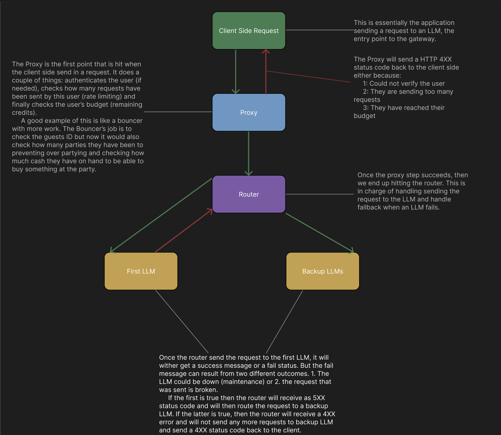

# LLM Gateway

Please take some time and read this README. It was not generated by AI and I promise there will be no AI slop.

#### Quick Intro
Before starting this project, I had no idea what it meant by gateway, so I looked into it and it turns out its a really useful tool to implement or take advantage of especially if you are in a situation where there are multiple teams that are using AI or simply want to add reliability to you website. 

However, making this project production ready for high scale applications would require adding backend auth, redis rate limiting and streaming support. The objective for this project is simply to learn about engineering a product from end-to-end keeping in mind scalability and reliability. This is the bare bones setup for a LLM Gateway and will be implemented on my personal website where the user talks to an LLM about my experiences, my interests and my plans for the future.

#### What is an LLM Gateway?

An LLM Gateway is meant to add a middleware between the client and the LLM. Now why would we want that instead of simply just calling an LLM Directly? Well, think about it this way, if the LLM you are calling has no rate limiting, no credit availability check, no backup LLM calls if one LLM is down, then the client can keep spam it with requests. The Gateway has two main components: a proxy and a router. Below is a diagram I built that explains all the components for a gateway. 

#### What does the Proxy do?
The proxy is mainly meant to verify the incoming request from the client and reject it if requirement are not met before it even hits the LLM API. For this project, the proxy is in charge of doing 3 things before sending the request to the LLM. 
- Authenticates the user making sure they have access to sending LLM requests
- Checks if there are API credits available for the user to use
- If they are sending too many requests all at once (making sure they haven't reached the rate-limiting limit)

#### What does the Router do?
Once the proxy checks are passed, the router then sends off the request to the LLMs depending on the team's priority for example (Try Claude first then ChatGPT or Gemini). If the first LLM fails then depending on if the LLM is down or if it is an invalid prompt it will either try the next LLM or if it sends a 4XX status code to the client. 
